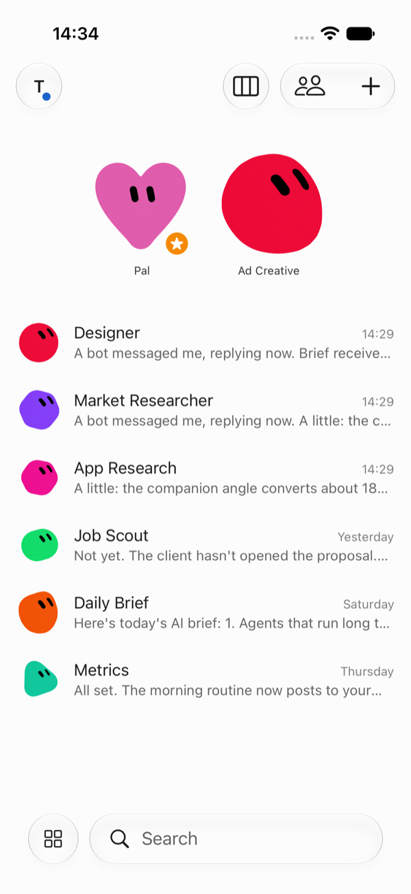
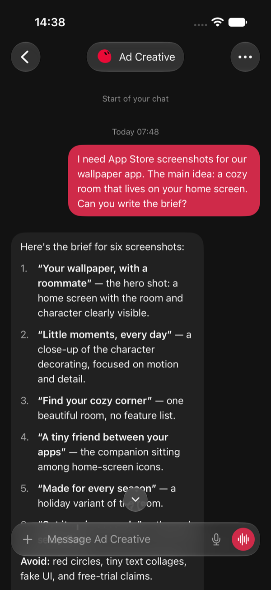
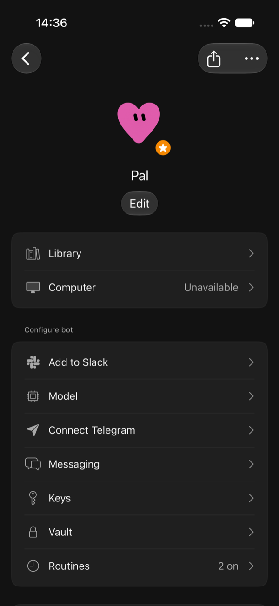
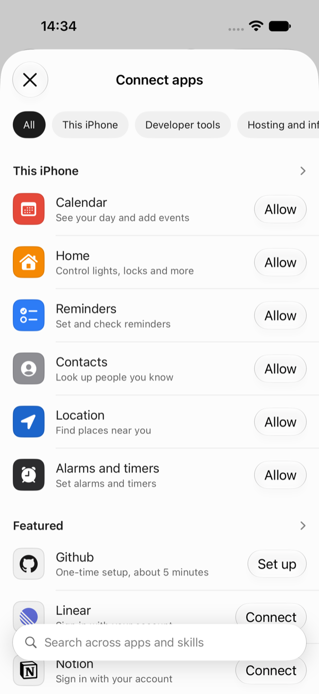

<p align="center">
  
</p>

<h1 align="center">Pal: your own AI agents on iPhone and Mac</h1>

<p align="center">
  <b>A native, self-hosted AI agent app.</b> Chat with a team of personal AI bots that run on your own machine,
  use your own models, connect to your own apps, and keep working while your phone is in your pocket.
</p>

<p align="center">
  <a href="https://github.com/tsnAnh/Pal/releases/latest"></a>
  
  <a href="LICENSE"></a>
  <a href="README.hermes-agent.md"></a>
</p>

<p align="center">
  
  
  
  
</p>

> [!WARNING]
> Pal is open source and very much a work in progress. It has plenty of bugs, so think twice before trusting it with anything important. Bug reports and pull requests are very welcome. Fun fact: I've been using Pal to improve Pal.

## What is Pal?

Pal is an open-source **AI assistant app for iPhone, iPad and Mac**, written in SwiftUI with Apple's Liquid Glass design. Each bot in Pal is a real agent with its own memory, skills, tools and schedule. The agents run on a computer you own (a Mac, a Raspberry Pi, a $5 VPS), and Pal is the remote control: sign in once and every bot is one tap away.

Pal is built on the [Hermes Agent](README.hermes-agent.md) engine by [Nous Research](https://nousresearch.com), so it works with any model provider: OpenRouter, OpenAI, Anthropic, Nous Portal, a local model or your own endpoint. No vendor lock-in, no hosted middleman, your data stays on your server.

## Why I built Pal

It started with a bot I really liked. I was using Grok's bot feature and having a great time: cute little helpers, chatting away, getting real things done. Then I looked at the price, and then at my usage limits, and my wallet quietly packed its bags and left the chat.

I was already paying for AI subscriptions. My wallet had already left the chat once, for a $200/month Claude Ultra plan. Paying again, at a premium, to hit a usage cap halfway through a Tuesday felt wrong. Meanwhile my ChatGPT subscription just kept going, and every so often Tibo at OpenAI hits the big usage-reset button and it's warm and full again. Practically bottomless. So I did what any reasonable developer does when a product costs too much: I spent far more hours than the subscription would ever have cost to build my own.

Pal is that build. It runs on the subscriptions and API keys you already have (yes, including that generously reset ChatGPT plan), so there's no extra monthly fee for the app. No usage meter except the one your model provider already has, and my bots do whatever I want them to, not just what a pricing tier allows. If you've ever stared at an AI pricing page and whispered "I could build that," this one's for you.

## Faker Kit: Pal's coding sidekick

Once Pal worked, I wanted one more thing: Cursor-style coding agents running in the cloud, kicked off from my phone. So I built that too and named it **Faker Kit**, after Faker, the GOAT of League of Legends (yes, I'm a huge fan).

Faker Kit does two jobs:

- **Manages project bots.** Each repository gets its own Pal bot that knows the codebase, triages work and reports back in chat.
- **Runs cloud coding sessions.** A bot can hand a task to a coding agent in a fresh cloud session, then watch the pull request through review and CI.

It's built on a lightly modified pstack by Lauren Tan ([@poteto](https://x.com/poteto)), adapted to the Pal and Faker Kit workflow. Full credit to her for the original.

## Features

| | |
|---|---|
| **A roster of personal AI bots** | Create as many bots as you need: a daily assistant, a researcher, an app-metrics watcher, a social writer. Pin favourites, pick a primary bot, see who is working, waiting for you or idle at a glance. |
| **Real agents, not chat wrappers** | Bots run tools, browse, write files, run terminal commands, remember what matters and get better at your tasks over time. Ask before anything risky: dangerous commands wait for your approval in the chat. |
| **Questions with answers to tap** | When a bot needs a decision it asks with tappable choices, so a reply takes one tap from the lock screen. |
| **Connected apps** | Slack, Google Workspace, Google Ads, Figma, Dropbox, Canva, Upwork and any MCP server. Sign-in happens in the system browser and tokens stay on your gateway, never on the phone. |
| **Bots on Slack, Telegram and Discord** | Put any bot in a Slack workspace, Telegram chat or Discord server, set up entirely from the app. |
| **Routines and boards** | Schedule recurring jobs in plain language (daily reports, weekly audits) and track multi-step work on a Kanban board. |
| **Computer view on Mac** | Watch and steer a bot's desktop session from the Mac app. |
| **Push notifications** | Get notified when a bot finishes, needs input or hits an error. |
| **Reach your Mac from anywhere** | Pair your iPhone with the Mac's local Pal engine over Tailscale, no port forwarding. |
| **Private by design** | Self-hosted gateway, secrets in a vault, sign-in through the system browser. |

## Download

- **Mac:** download the latest signed build from [Releases](https://github.com/tsnAnh/Pal/releases/latest). It updates itself with Sparkle.
- **iPhone and iPad:** build from source (below).

## Install the Pal gateway

Pal talks to the **Pal gateway**, the Hermes engine from this repository with Pal's own app API (bot roster, sign-in, connected apps, push). A stock upstream Hermes install does not serve it, so install from this repo.

**On a Mac:** open Pal for Mac and choose to install Pal on this Mac. The app installs the gateway from this repository, runs it as a background service, and signs you in. Your iPhone can then reach it over Tailscale.

**On a server (Linux, macOS or WSL2: a Raspberry Pi, a VPS):**

```bash
curl -fsSL https://raw.githubusercontent.com/tsnAnh/Pal/main/scripts/install.sh \
  | HERMES_REPO_URL=https://github.com/tsnAnh/Pal.git bash -s -- --branch main
hermes setup              # pick a model provider
hermes gateway install    # run the gateway as a background service
```

The installer may ask for `sudo` once to add missing system libraries. Open a new terminal (or `source ~/.bashrc`) afterwards so `hermes` is on your PATH. Keep it current with `hermes update`, which pulls from this repository.

Then open Pal, choose **Other options**, enter your gateway address and sign in.

## Build from source

Requirements: Xcode 26 or later, [XcodeGen](https://github.com/yonaskolb/XcodeGen), macOS 26.

```bash
git clone https://github.com/tsnAnh/Pal.git
cd Pal/apps/ios
xcodegen generate
open Pal.xcodeproj
```

Pick the `Pal` scheme, choose an iPhone simulator or **My Mac**, and run. The app code lives in [`apps/ios`](apps/ios), with shared packages in [`PalKit`](apps/ios/Packages/PalKit) (networking, gateway client, connectors) and [`PalDesign`](apps/ios/Packages/PalDesign) (Liquid Glass components, animated bot avatars).

The agent engine, gateway and CLI are Python and live at the repository root. See [README.hermes-agent.md](README.hermes-agent.md) and the [Hermes docs](https://hermes-agent.nousresearch.com/docs/) for engine setup, providers, skills and plugins.

## How it works

```
 iPhone / iPad / Mac (Pal, SwiftUI)
        │  HTTPS + live connection, signed in once
        ▼
 Pal gateway (your Mac, Pi or VPS)
        │  one profile per bot: memory, skills, tools, schedules
        ▼
 Your model provider  ·  Your connected apps  ·  Slack / Telegram
```

## FAQ

**Is Pal free?** Yes. Pal is open source under the MIT license. Bring a subscription you already pay for (such as ChatGPT through Codex sign-in, or GitHub Copilot), an API key, or a local model for no model cost at all.

**Which AI models does Pal support?** Any model Hermes Agent supports: OpenRouter, OpenAI, Anthropic, Google, Nous Portal, local OpenAI-compatible servers and more.

**Where is my data stored?** On the gateway you run. Pal has no hosted backend.

**Does Pal run on Android or Windows?** Pal is Apple-only. The Hermes engine underneath runs on Linux, macOS, Windows and Android (Termux).

## Credits

Pal is built on [Hermes Agent](https://github.com/NousResearch/hermes-agent) by [Nous Research](https://nousresearch.com), released under the MIT license. The original project README is kept, with thanks, at [README.hermes-agent.md](README.hermes-agent.md).

## License

[MIT](LICENSE). Copyright (c) 2025 Nous Research, and the Pal contributors for their changes.

Pal is an independent project. Product and company names mentioned here are trademarks of their owners and do not imply endorsement.
